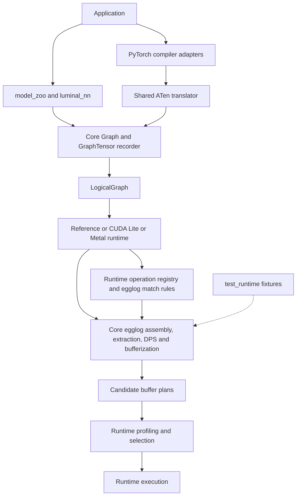
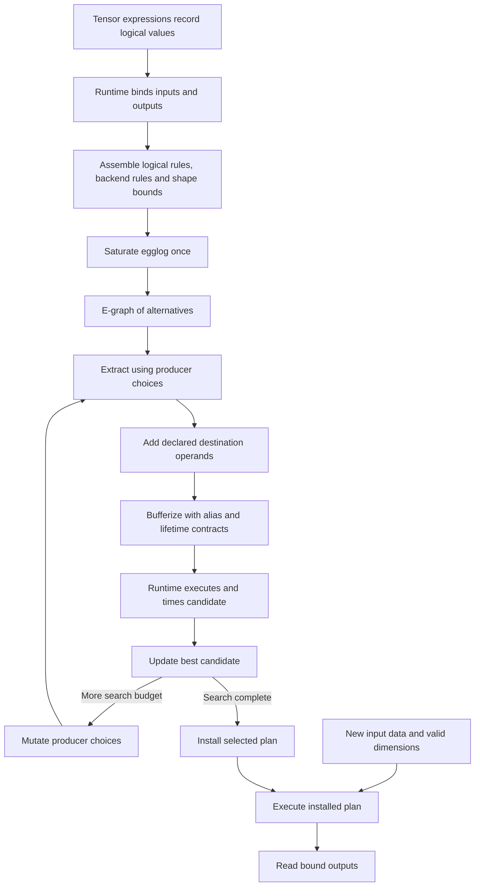
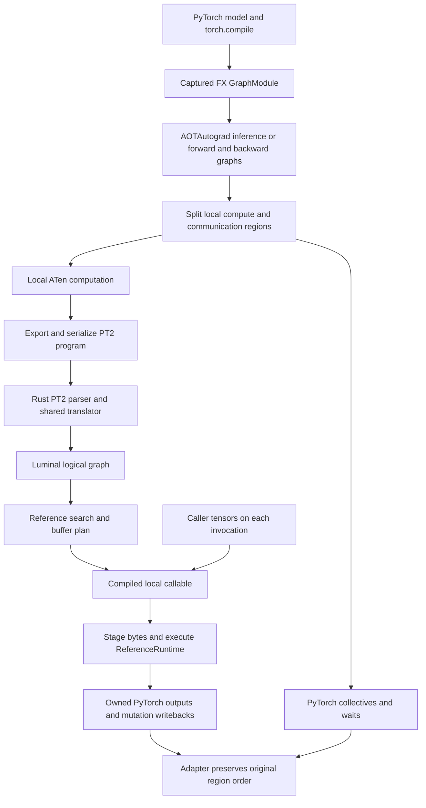

# Luminal architecture diagrams

These diagrams summarize the current source relationships. Arrows show computation
flow or use of shared machinery, not an exhaustive Cargo dependency graph.

## Component ownership

The runtime drives compilation using core machinery and its own operation set.
`test_runtime` exercises plan properties and has no kernel executor.
Evidence: [core modules](../../src/lib.rs),
[reference modules](../../crates/luminal_reference/src/lib.rs), and
[test_runtime](../../tests/test_runtime/src/lib.rs).

## Compilation and execution

Invalid candidates can be rejected during extraction, planning, or runtime
validation; those exits are omitted. Profiling belongs to compilation, so search
requires a working executor. Subsequent execution reuses the selected plan.
Evidence: [reference search](../../crates/luminal_reference/src/search.rs),
[runtime lifecycle](../../crates/luminal_reference/src/runtime.rs), and
[DPS lowering](../../src/layout/dps.rs).

## PyTorch reference integration

Single-process graphs may have no communication regions. PyTorch owns
differentiation and communication; Luminal compiles local compute regions.
The CUDA adapter has a different compilation and storage-binding path.
Evidence: [AOT adapter](../../crates/pytorch/reference/python/luminal_reference/aot.py),
[local backend](../../crates/pytorch/reference/python/luminal_reference/backend.py),
[native binding](../../crates/pytorch/reference/src/lib.rs), and
[translator](../../crates/pytorch/utils/src/translate.rs).
